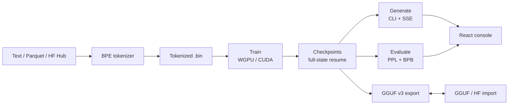

# Noctámbulo

**Train it overnight. Wake up to a model.**

[](https://www.rust-lang.org/)
[](https://burn.dev/)
[](https://wgpu.rs/)
[](#verification)
[](doc/models/export.md)
[](#web-console)
[](LICENSE)

Noctámbulo (`noctambulo-llm`) is an end-to-end LLM engine written in **Rust** on top of
**Burn 0.21** and **WGPU**: byte-level BPE tokenizer, dataset pipeline, training,
evaluation, inference, GGUF import/export, third-party model conversion and a React web
console. One CLI, one binary, no Python runtime.



## Why “Noctámbulo”?

*Noctámbulo* is Spanish for **night owl**. The engine is designed for exactly that:
long, unattended training runs.

- **Full-state checkpoints**: weights, AdamW moments, LR schedule and shuffler RNG survive
  a restart; `--resume` continues exactly where it stopped.
- **Safe stop**: `Ctrl+C` saves an interrupted checkpoint instead of losing the night.
- **Early stopping, sequence warmup, gradient accumulation** and cosine LR with warmup.
- **Bounded caches** for long generations: the KV cache never grows without control.
- **Run history + live telemetry** in the web console: loss/val curves, tok/s, CPU/RSS/GPU.
- **Background operations** with progress and cancellation: downloads, mixes, imports,
  exports.

Start it before bed. Check the loss curve over coffee.

## Highlights

**Training**
- Qwen-style decoder: RMSNorm, SwiGLU, RoPE, GQA, tied word embeddings, optional
  attention softcap.
- Configurable architecture: presets (`nano`/`tiny`/`small`/`base`) or explicit
  `--n-embd/--n-head/--n-kv-head/--n-layer/--n-ctx`, plus custom FFN size, RMSNorm epsilon
  and RoPE theta for imported models.
- AdamW with decoupled weight decay, gradient clipping, label smoothing, z-loss.
- Datasets from plain text, Parquet (direct ingest, no intermediate `.txt`) or the Hugging
  Face Hub; exact-duplicate removal, weighted mixing, `.bin` fingerprints.
- f32 training on WGPU (or CUDA with `--features cuda`); records are always f32.

**Inference**
- Top-K, Top-P, Min-P, temperature and repetition penalty.
- Streaming tokens over SSE with cancellation and live tok/s.
- f32/f16 compute and f32/f16/int8/q4 KV cache storage.
- RoPE context extension: `linear`, `ntk`, `yarn` — generate past the trained window.

**KV cache engineering** (the part most engines leave on the table)

| Feature | Flags | What it does |
| --- | --- | --- |
| Preallocated ring cache | — | In-place `slice_assign`, no per-token reallocation |
| Sliding window + sinks | `--sliding-window`, `--sink-tokens` | Bounded ring with StreamingLLM sinks |
| Cross-layer KV sharing | `--kv-share-group N` | One K/V projection + cache per N layers |
| MLA latent cache | `--mla-latent-dim D` | Cache only a compressed latent, expand on the fly |
| Heavy-hitter eviction (H2O) | `--kv-eviction h2o --kv-budget N` | Keep sinks + recent + highest attention mass |
| Host-RAM spill/replay | `--kv-spill --kv-max-budget N --kv-grow R` | Archive evicted rows and replay by score |
| Quantized cache | `--kv-cache-dtype int8\|q4` | Packed integers + per-block scales |

**Third-party models**
- `import-hf`: convert Hugging Face safetensors (Llama / Qwen2 / Mistral, f32/f16/bf16,
  sharded, custom FFN size, RoPE base/eps from the config) on the CPU, without VRAM.
- `import`: read compatible `llama`/`qwen2` GGUFs (f32/f16), with `--tokenizer` override.
- Fine-tune any imported model with `train --resume <model_dir>`.
- Clear errors for QK-norms (Qwen3), SentencePiece tokenizers, untied `lm_head` and
  quantized safetensors.
- `export`: GGUF v3 with llama.cpp-compatible tensor layout, RoPE scaling and sliding
  window metadata.

**Web console**
- React 19 + Vite + TypeScript + Tailwind v4, built locally (no CDN), served by Axum.
- Train wizard (data → architecture → schedule → review) with inline validation and live
  parameter count.
- Live loss/val charts, worker logs over SSE, run history with overlay.
- Datasets: HF file picker, downloads, weighted mixing, duplicate removal.
- Models: source badges, architecture details, file downloads, rename/delete, GGUF and HF
  imports with progress.
- Devices: CPU/GPU/NPU detection, host system card, real-time telemetry.

## Quickstart

Requirements: Rust 1.92+ (edition 2024), a Vulkan/Metal/DX12 GPU (WGPU), and Node.js 20+ only for the web
console.

```bash
git clone https://github.com/Hoosk/noctambulo-llm.git
cd noctambulo-llm
cargo build --release
```

```bash
# 1. Train a BPE tokenizer (8k vocabulary)
cargo run --release -- train-tokenizer --dataset roneneldan/TinyStories --vocab-size 8000

# 2. Train a tiny model (Chinchilla-style token budget warning included)
cargo run --release -- train --dataset roneneldan/TinyStories \
  --max-tokens 100000000 --epochs 3 --save-dir checkpoints

# 3. Generate
cargo run --release -- generate "Once upon a time" \
  --temp 0.7 --top-k 40 --top-p 0.9 --min-p 0.05

# 4. Evaluate (PPL + bits-per-byte) and inspect memory
cargo run --release -- eval --file datasets/corpus.txt
cargo run --release -- stats

# 5. Export to GGUF v3 (llama.cpp / LM Studio / Ollama)
cargo run --release -- export --model-name noctambulo
```

The finished model lives in `model_output/` (`config.json`, `model_weights.bin`,
`custom_tokenizer.json`).

### Web console

```bash
cd web && npm install && npm run build && cd ..
cargo run --release -- serve --bind 127.0.0.1:8080 --token change-me
```

Open `http://127.0.0.1:8080`, log in with the token, and drive training, datasets,
generation, models and exports from the browser.

### Third-party models

```bash
# Convert Qwen2.5-0.5B-Instruct from the Hub (CPU conversion, ~2 GB f32 output)
cargo run --release -- import-hf --repo Qwen/Qwen2.5-0.5B-Instruct \
  --output-dir model_output/qwen2.5-0.5b

cargo run --release -- generate --model-dir model_output/qwen2.5-0.5b \
  "The capital of France is"

# Fine-tune the imported model; its config.json defines the architecture
cargo run --release -- train --resume model_output/qwen2.5-0.5b \
  --file datasets/corpus.txt --epochs 1 --lr 0.00002 --max-tokens 5000000
```

See [doc/models/import.md](doc/models/import.md) for supported architectures, GGUF details and known
limitations.

## Verification

```bash
cargo test                  # 109 tests
cargo clippy --all-targets  # clean
cd web && npm run lint && npm run build
```

Covered: tokenizer/datasets, full-state resume, gradient accumulation, eval/BPB, cached
decode parity (f32/f16/int8/q4, MLA, sharing, sliding window), H2O eviction invariants,
spill/replay dense-context parity, GGUF export/import golden layout, HF safetensors
conversion roundtrip, API paths and web build.

### Measured on the development machine

Internal smoke benchmarks — useful as a sanity check, not as marketing numbers:

| Workload | Result |
| --- | --- |
| Tiny 2-layer model, dense decode | 73–78 tok/s |
| Same model, H2O eviction (budget 64) | 65–68 tok/s (~10% overhead) |
| Same model, spill/replay with budget growth | 36–43 tok/s |
| Qwen2.5-0.5B-Instruct, f32 on WGPU (integrated GPU) | ~1 tok/s |
| Qwen2.5-0.5B safetensors → native conversion | ~2m45s (download + CPU convert) |
| Compatible f16 GGUF import | 12–45s |

## Project layout

```text
src/
  main.rs        CLI (clap)
  model.rs       decoder, attention, KV cache formats + eviction
  train.rs       training loop, eval, checkpoints
  generate.rs    sampling, SSE streaming, growth schedule
  data.rs        tokenizer, datasets, HF downloads
  export.rs      GGUF v3 writer
  import.rs      GGUF reader
  hf_import.rs   safetensors → native converter
  serve/         Axum API, ops, run history, telemetry
web/             React console (Vite + Tailwind)
doc/             architecture, training/, inference/, models/
```

## Documentation

- [Architecture](doc/architecture.md) — decoder, RoPE, GQA, RMSNorm, SwiGLU.
- [Training](doc/training/train.md) — schedule, optimizer, regularization, datasets, eviction mask.
- [Generation](doc/inference/generate.md) — sampling, KV cache, H2O eviction, spill/replay.
- [GGUF export](doc/models/export.md) and [third-party import](doc/models/import.md).
- [Statistics](doc/models/stats.md) — params, FLOPs, cache budgets.
- [Roadmap](ROADMAP.md).

## Known limits

- Training and records are **f32 only** (Burn 0.21's f16 optimizer states underflow).
- GGUF import accepts f32/f16 tensors; quantized GGUF dequantization is on the roadmap.
- QK-norm architectures (Qwen3) and SentencePiece tokenizers are not supported yet.
- The CUDA backend is compile-checked; validate it on your NVIDIA host before relying on it.
- The web console is meant for trusted local networks: use `--token` when exposing it.

## License

[MIT](LICENSE) © 2026 Hoosk
