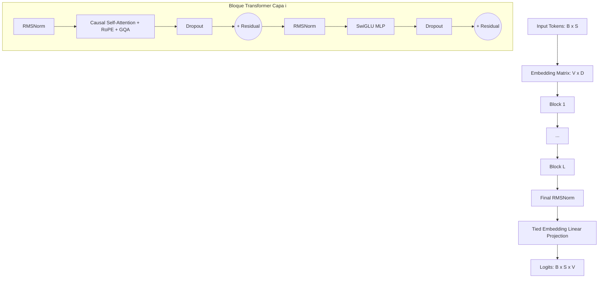

# 🧠 Kuro-Neko — Arquitectura del Modelo

Este documento ofrece una especificación técnica detallada sobre la arquitectura interna de red neuronal implementada en **Kuro-Neko**.

La arquitectura está inspirada en la familia de modelos **Qwen2.5 / Qwen3**, construida como un Transformer Causal (*Decoder-Only*) de alto rendimiento optimizado para entrenamiento e inferencia masivamente paralela en GPU mediante el framework **Burn 0.21** y **WGPU**.

---

## 🏛️ Diagrama General de la Arquitectura



---

## 🔬 Componentes Técnicos Detallados

### 1. Embedded Word Tying e Inicialización Gaussian Normal $\mathcal{N}(0, 0.02)$

Kuro-Neko implementa **Tied Word Embeddings** (`tie_word_embeddings = true`). 

- **Compartición de Pesos**: La matriz de entrada de embedding `embed_tokens` con forma $[V, D]$ se transpone y se reutiliza directamente como la matriz de proyección final para calcular los logits sobre el vocabulario:
  $$\text{logits} = X \times W_{\text{embed}}^T$$
- **Estrategia de Inicialización**: Para evitar la saturación rápida de los logits y explosión de gradientes en las fases iniciales del entrenamiento con pesos compartidos, la matriz `embed_tokens` se inicializa con una distribución gaussiana normal de media $0.0$ y desviación estándar de $0.02$:
  $$W_{\text{embed}} \sim \mathcal{N}(0.0,\, 0.02)$$

---

### 2. RoPE (Rotary Position Embedding) con $\theta = 1.000.000$ / $10.000,0$

La información posicional no se suma a los embeddings de entrada, sino que se incorpora mediante rotaciones complejas sobre los vectores de Query ($Q$) y Key ($K$) dentro de cada cabeza de atención.

- **Base de Frecuencia**: $\theta = 10.000,0$ (o $1.000.000$ para contextos extensos).
- **Frecuencias Posicionales**: Para cada dimensión par $2i \in [0, d_k)$:
  $$\theta_i = \frac{1}{\theta^{2i / d_k}}$$
- **Rotación en el Plano 2D**:
  $$R_{\Theta, m}^d x_m = \begin{pmatrix} x_m^{(1)} \cos(m\theta_1) - x_m^{(2)} \sin(m\theta_1) \\ x_m^{(1)} \sin(m\theta_1) + x_m^{(2)} \cos(m\theta_1) \\ \vdots \end{pmatrix}$$
- **Precálculo de Caché**: Las matrices de seno y coseno ($\cos, \sin$) para toda la ventana de contexto `n_ctx` se precalculan al instanciar el modelo (`precompute_rope_cache`), evitando cálculos redundantes durante las pasadas forward.

---

### 3. Grouped Query Attention (GQA)

Para equilibrar la calidad de representación con la eficiencia en VRAM de la **Caché KV**, Kuro-Neko soporta **Grouped Query Attention (GQA)**:

- **Proporción de Cabezas**: Se definen $H$ cabezas para Query y $H_{\text{kv}}$ cabezas para Key y Value, donde $H$ debe ser divisible entre $H_{\text{kv}}$.
- **Repetición KV**: Cada cabeza $KV$ se expande y se comparte entre $N_{\text{rep}} = H / H_{\text{kv}}$ cabezas $Q$ mediante la función `repeat_kv`:

```rust
fn repeat_kv<B: Backend>(x: Tensor<B, 4>, n_rep: usize) -> Tensor<B, 4> {
    if n_rep == 1 {
        x
    } else {
        let [b, n_kv_head, s, d] = x.dims();
        x.unsqueeze_dim::<5>(2)
            .expand([b, n_kv_head, n_rep, s, d])
            .reshape([b, n_kv_head * n_rep, s, d])
    }
}
```

- **Sesgo en Proyecciones QKV**: Siguiendo el estándar Qwen, las proyecciones `q_proj`, `k_proj` y `v_proj` incluyen sesgo activo (`with_bias(true)`).

---

### 4. SwiGLU MLP Alineado a Múltiples de 256

El bloque de Feed-Forward Network (FFN) utiliza la activación **SwiGLU (Swish-Gated Linear Unit)**:

- **Ecuación Operativa**:
  $$\text{SwiGLU}(x) = \left( \text{SiLU}(x W_{\text{gate}}) \odot (x W_{\text{up}}) \right) W_{\text{down}}$$
- **Cálculo de Dimensión Oculta Alineada**: La dimensión oculta raw $\lfloor \frac{8D}{3} \rfloor$ se redondea superiormente al múltiplo de 256 más cercano para maximizar la alineación con los núcleos SIMD/Tensor Cores de la GPU:

```rust
let raw_hidden_dim = (8 * self.n_embd) / 3;
let hidden_dim = ((raw_hidden_dim + 255) / 256) * 256;
```

---

### 5. RMSNorm (Root Mean Square Normalization) con $\epsilon = 10^{-6}$

Tanto las normalizaciones previas a la atención (*Pre-Attention Norm*) como las previas a la MLP (*Pre-FFN Norm*) emplean **RMSNorm** en lugar de LayerNorm estándar:

- **Ecuación**:
  $$\text{RMSNorm}(x) = \frac{x}{\sqrt{\frac{1}{d} \sum_{i=1}^d x_i^2 + \epsilon}} \odot \gamma$$
- **Parámetro Epsilon**: $\epsilon = 10^{-6}$ (Estándar Qwen2.5 / Qwen3).
- **Eficiencia**: Omite el cálculo de la media poblacional, reduciendo las pasadas por memoria en la GPU en un 50% con respecto a LayerNorm.

---

### 6. Attention Softcapping (Opcional, Estilo Gemma 4)

Para estabilizar la magnitud de las puntuaciones de atención durante el entrenamiento de modelos profundos, Kuro-Neko admite la aplicación opcional de **Attention Softcapping**:

- **Fórmula**:
  $$\text{scores} = \text{softcap} \times \tanh\left( \frac{Q K^T}{\sqrt{d_k} \times \text{softcap}} \right)$$
- **Comportamiento**: Si `attn_softcap = 0.0` (por defecto), la operación se omite. Si se configura a un valor como `50.0`, acota suavemente los scores de atención en el rango $[-50.0, 50.0]$, impidiendo gradientes infinitos o desbordamientos numéricos.

---

## 📊 Resumen de Hiperparámetros de la Arquitectura

| Parámetro | Símbolo | Tipo | Función |
| :--- | :--- | :--- | :--- |
| `vocab_size` | $V$ | `usize` | Tamaño total del vocabulario BPE |
| `n_embd` | $D$ | `usize` | Dimensión de embedding y del estado oculto principal |
| `n_head` | $H$ | `usize` | Número de cabezas de atención Query |
| `n_kv_head` | $H_{\text{kv}}$ | `usize` | Número de cabezas KV para GQA ($H_{\text{kv}} \le H$) |
| `n_layer` | $L$ | `usize` | Número de bloques Transformer |
| `n_ctx` | $N_{\text{ctx}}$ | `usize` | Longitud máxima de la ventana de contexto |
| `dropout` | $P_{\text{drop}}$ | `f64` | Probabilidad de regularización por dropout |
| `attn_softcap` | $C_{\text{soft}}$ | `f32` | Umbral de acotamiento de puntuaciones de atención |
