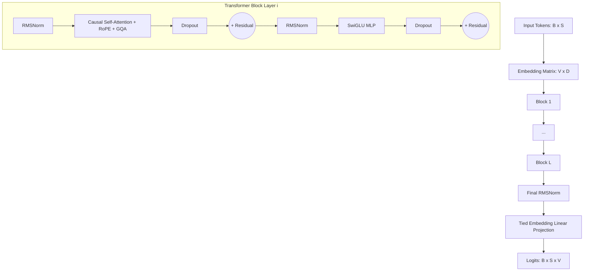

# 🧠 Kuro-Neko — Model Architecture

This document provides a detailed technical specification of the neural network architecture implemented in **Kuro-Neko**.

The architecture is inspired by the **Qwen2.5 / Qwen3** model family, built as a high-performance Causal Transformer (*Decoder-Only*) optimized for massively parallel training and inference on GPU using the **Burn 0.21** and **WGPU** frameworks.

---

## 🏛️ General Architecture Diagram



---

## 🔬 Detailed Technical Components

### 1. Embedded Word Tying and Gaussian Normal Initialization $\mathcal{N}(0, 0.02)$

Kuro-Neko implements **Tied Word Embeddings** (`tie_word_embeddings = true`).

- **Weight Sharing**: The embedding input matrix `embed_tokens` with shape $[V, D]$ is transposed and reused directly as the final projection matrix to compute the logits over the vocabulary:
  $$\text{logits} = X \times W_{\text{embed}}^T$$
- **Initialization Strategy**: To avoid rapid logit saturation and gradient explosion in the early phases of training with shared weights, the `embed_tokens` matrix is initialized with a Gaussian normal distribution with mean $0.0$ and standard deviation $0.02$:
  $$W_{\text{embed}} \sim \mathcal{N}(0.0,\, 0.02)$$

---

### 2. RoPE (Rotary Position Embedding) with $\theta = 1.000.000$ / $10.000,0$

Positional information is not added to the input embeddings; instead, it is incorporated through complex rotations on the Query ($Q$) and Key ($K$) vectors within each attention head.

- **Frequency Base**: $\theta = 10.000,0$ by default; imported models carry their own value (`rope_theta` / `rope.freq_base`, e.g. $10^6$ for Qwen2.5, $5\cdot10^5$ for Llama-3).
- **Positional Frequencies**: For each even dimension $2i \in [0, d_k)$:
  $$\theta_i = \frac{1}{\theta^{2i / d_k}}$$
- **2D Plane Rotation**:
  $$R_{\Theta, m}^d x_m = \begin{pmatrix} x_m^{(1)} \cos(m\theta_1) - x_m^{(2)} \sin(m\theta_1) \\ x_m^{(1)} \sin(m\theta_1) + x_m^{(2)} \cos(m\theta_1) \\ \vdots \end{pmatrix}$$
- **Cache Precomputation**: The sine and cosine matrices ($\cos, \sin$) for the entire `n_ctx` context window are precomputed when instantiating the model (`precompute_rope_cache`), avoiding redundant computations during forward passes.

---

### 3. Grouped Query Attention (GQA)

To balance representation quality with the VRAM efficiency of the **KV Cache**, Kuro-Neko supports **Grouped Query Attention (GQA)**:

- **Head Ratio**: $H$ heads are defined for Query and $H_{\text{kv}}$ heads for Key and Value, where $H$ must be divisible by $H_{\text{kv}}$.
- **KV Repetition**: Each $KV$ head is expanded and shared across $N_{\text{rep}} = H / H_{\text{kv}}$ $Q$ heads via the `repeat_kv` function:

```rust
fn repeat_kv<B: Backend>(x: Tensor<B, 4>, n_rep: usize) -> Tensor<B, 4> {
    if n_rep == 1 {
        x
    } else {
        let [b, n_kv_head, s, d] = x.dims();
        x.unsqueeze_dim::<5>(2)
            .expand([b, n_kv_head, n_rep, s, d])
            .reshape([b, n_kv_head * n_rep, s, d])
    }
}
```

- **Bias in QKV Projections**: Following the Qwen standard, the `q_proj`, `k_proj`, and `v_proj` projections include an active bias (`with_bias(true)`).

---

### 4. SwiGLU MLP Aligned to Multiples of 256

The Feed-Forward Network (FFN) block uses the **SwiGLU (Swish-Gated Linear Unit)** activation:

- **Operational Equation**:
  $$\text{SwiGLU}(x) = \left( \text{SiLU}(x W_{\text{gate}}) \odot (x W_{\text{up}}) \right) W_{\text{down}}$$
- **Aligned Hidden Dimension Calculation**: The raw hidden dimension $\lfloor \frac{8D}{3} \rfloor$ is rounded up to the nearest multiple of 256 to maximize alignment with the GPU's SIMD/Tensor Cores:

```rust
let raw_hidden_dim = (8 * self.n_embd) / 3;
let hidden_dim = ((raw_hidden_dim + 255) / 256) * 256;
```

---

### 5. RMSNorm (Root Mean Square Normalization) with $\epsilon = 10^{-6}$

Both the pre-attention normalizations (*Pre-Attention Norm*) and the pre-MLP normalizations (*Pre-FFN Norm*) use **RMSNorm** instead of standard LayerNorm:

- **Equation**:
  $$\text{RMSNorm}(x) = \frac{x}{\sqrt{\frac{1}{d} \sum_{i=1}^d x_i^2 + \epsilon}} \odot \gamma$$
- **Epsilon Parameter**: $\epsilon = 10^{-6}$ by default; imported models use their `rms_norm_eps` (e.g. $10^{-5}$ for Llama).
- **Efficiency**: It skips the population mean computation, reducing memory passes on the GPU by 50% compared to LayerNorm.

---

### 6. Attention Softcapping (Optional, Gemma 4 Style)

To stabilize the magnitude of attention scores during the training of deep models, Kuro-Neko supports the optional application of **Attention Softcapping**:

- **Formula**:
  $$\text{scores} = \text{softcap} \times \tanh\left( \frac{Q K^T}{\sqrt{d_k} \times \text{softcap}} \right)$$
- **Behavior**: If `attn_softcap = 0.0` (default), the operation is skipped. If set to a value such as `50.0`, it smoothly bounds the attention scores to the range $[-50.0, 50.0]$, preventing infinite gradients or numerical overflows.

---

## 📊 Architecture Hyperparameter Summary

| Parameter | Symbol | Type | Function |
| :--- | :--- | :--- | :--- |
| `vocab_size` | $V$ | `usize` | Total BPE vocabulary size |
| `n_embd` | $D$ | `usize` | Embedding and main hidden state dimension |
| `n_head` | $H$ | `usize` | Number of Query attention heads |
| `n_kv_head` | $H_{\text{kv}}$ | `usize` | Number of KV heads for GQA ($H_{\text{kv}} \le H$) |
| `n_layer` | $L$ | `usize` | Number of Transformer blocks |
| `n_ctx` | $N_{\text{ctx}}$ | `usize` | Maximum context window length |
| `dropout` | $P_{\text{drop}}$ | `f64` | Dropout regularization probability |
| `attn_softcap` | $C_{\text{soft}}$ | `f32` | Attention score bounding threshold |
