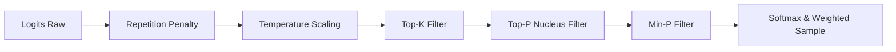

# 🔤 Kuro-Neko — Generación e Inferencia (`generate`)

El subcomando `generate` permite realizar inferencia autorregresiva de texto a partir de un texto semilla (*prompt*). Carga los pesos entrenados guardados en `model_output/` junto con la configuración de la arquitectura (`config.json`) y el tokenizador BPE (`custom_tokenizer.json`), generando tokens consecutivamente mediante un pipeline optimizado con **Caché KV** (Key-Value Cache) y muestreo estocástico avanzado.

---

## ⚙️ Tabla Completa de Parámetros CLI

| Flag / Argumento | Tipo | Valor por Defecto | Descripción Detallada |
| :--- | :--- | :--- | :--- |
| `<prompt>` *(Posicional)* | `String` | **Requerido** | Texto semilla de entrada a partir del cual el modelo continuará la generación de texto. |
| `--temp <float>` | `f32` | `0.7` | Temperatura de muestreo ($T$). Escala los logits antes del softmax. Valores mayores aumentan la diversidad/creatividad, mientras que valores cercanos a `0.0` hacen el resultado determinista. |
| `--top-k <n>` | `usize` | `40` | Muestreo Top-K. Restringe la selección a únicamente los $K$ tokens con mayor probabilidad desestimando el resto. |
| `--top-p <float>` | `f32` | `0.9` | Muestreo Nucleus (Top-P). Conserva el conjunto mínimo de tokens cuya suma de probabilidades acumuladas alcanza o supera el umbral $p$. |
| `--min-p <float>` | `f32` | `0.05` | Umbral Min-P. Excluye cualquier token cuya probabilidad sea inferior a $\text{min\_p} \times P_{\max}$, eliminando la "cola ruidosa" de distribuciones planas. |
| `--rep-penalty <float>` | `f32` | `1.1` | Penalización por repetición. Aplica un factor divisor sobre los logits de los tokens que ya han sido generados previamente en la secuencia. `1.0` la desactiva. |
| `--max-tokens <n>` | `usize` | `50` | Número máximo de nuevos tokens a generar de manera autorregresiva. |
| `--seed <n>` | `Option<u64>` | `None` *(Tiempo de sistema)* | Semilla aleatoria para el generador `XorshiftRng`. Permite reproducir exactamente la misma salida de texto. |

---

## 🎯 Explicación Detallada de las Estrategias de Muestreo

Kuro-Neko aplica un pipeline secuencial de filtrado y transformación sobre el vector de logits desnormalizados $z \in \mathbb{R}^{V}$ para seleccionar el siguiente token:



### 1. Penalización por Repetición (Repetition Penalty)
Para cada token $i$ que ya está presente en el contexto o en el texto generado previamente, su logit $z_i$ se ajusta según:
$$z_i \leftarrow \begin{cases} z_i / \text{rep\_penalty} & \text{si } z_i > 0 \\ z_i \times \text{rep\_penalty} & \text{si } z_i \le 0 \end{cases}$$
Un valor como `1.1` o `1.2` desincentiva suavemente los bucles de repetición infinita.

### 2. Escala de Temperatura (Temperature Scaling)
Los logits modificados se dividen por la temperatura $T$:
$$z_i' = \frac{z_i}{T}$$
- Si $T \to 0$, la distribución se concentra en el token con la mayor probabilidad (búsqueda codiciosa / *greedy search*).
- Si $T > 1.0$, la distribución de probabilidad se aplana, otorgando mayor oportunidad a tokens menos frecuentes.

### 3. Muestreo Top-K
Se ordenan los logits descendentemente y se conservan únicamente las $K$ mejores posiciones. Todas las demás posiciones en el vector de logits reciben un valor de $-\infty$ (o $-10^4$), eliminándolas del cálculo de probabilidades.

### 4. Muestreo Nucleus (Top-P)
Tras aplicar Softmax a los logits filtrados, se acumulan las probabilidades en orden descendente. Se conserva el subconjunto más pequeño de tokens $\mathcal{S}$ tal que:
$$\sum_{j \in \mathcal{S}} P(j) \ge p$$
Los tokens fuera de este conjunto acumulado son descartados. Esto adapta dinámicamente la cantidad de candidatos según la incertidumbre del modelo.

### 5. Umbral Min-P (Min-P Thresholding)
Min-P es una técnica moderna de filtrado estocástico. Sea $P_{\max} = \max_i P(i)$ la probabilidad del token más probable. Un token $k$ solo se conserva si cumple:
$$P(k) \ge \text{min\_p} \times P_{\max}$$
Si el token candidato principal tiene un 80% de probabilidad y `min_p = 0.05`, solo se considerarán tokens con al menos $4\%$ de probabilidad ($0.05 \times 0.80$).

### 6. Muestreo con Generador XorshiftRng
Finalmente, las probabilidades resultantes se re-normalizan y se muestrea el token seleccionado mediante un generador pseudoaleatorio ultra-rápido `XorshiftRng`:

```rust
let mut rng = XorshiftRng::new(seed);
let r = rng.next_f32();
```

---

## ⚙️ Perfiles de Generación Recomendados

### 🎨 Perfil Creativo (Escritura de historias, poesía, ideas)
Maximiza la variabilidad y el vocabulario sin perder coherencia gramatical:
```bash
cargo run --release -- generate "In a distant galaxy" \
  --temp 0.9 \
  --top-k 50 \
  --top-p 0.95 \
  --min-p 0.02 \
  --rep-penalty 1.05 \
  --max-tokens 100
```

### 🎯 Perfil Determinista / Técnico (Código, hechos, resúmenes)
Respuestas concisas y directas enfocadas en el token con mayor probabilidad:
```bash
cargo run --release -- generate "The function of RMSNorm is" \
  --temp 0.2 \
  --top-k 10 \
  --top-p 0.80 \
  --min-p 0.10 \
  --rep-penalty 1.20 \
  --max-tokens 50
```

### ⚖️ Perfil Balanceado (Uso General)
Equilibrio óptimo entre diversidad y precisión:
```bash
cargo run --release -- generate "Once upon a time" \
  --temp 0.7 \
  --top-k 40 \
  --top-p 0.90 \
  --min-p 0.05 \
  --rep-penalty 1.10 \
  --max-tokens 60
```

---

## ⚡ Funcionamiento de la Caché KV (Prefill & Decode)

Para lograr una generación de texto extremadamente rápida en GPU sin recalcular los tensores de clave y valor para tokens pasados en cada paso, Kuro-Neko utiliza una estructura **`KvCache`**:

```rust
pub struct KvCache<B: Backend> {
    pub k: Option<Tensor<B, 4>>,
    pub v: Option<Tensor<B, 4>>,
}
```

El proceso de inferencia se divide en dos fases distintas:

### Fase 1: Prefill (Evaluación del Prompt)
1. El texto inicial (*prompt*) de longitud $S$ se convierte a tokens e ingresa al modelo en una sola pasada paralela.
2. Cada bloque de atención calcula las matrices $K \in \mathbb{R}^{B \times H_{\text{kv}} \times S \times D}$ y $V \in \mathbb{R}^{B \times H_{\text{kv}} \times S \times D}$.
3. Estas matrices iniciales se almacenan dentro de la estructura `KvCache` correspondiente a cada capa del Transformer.

### Fase 2: Decode (Generación Autorregresiva Paso a Paso)
1. Para generar el token $N+1$, únicamente se pasa al modelo el **último token generado** (longitud $S = 1$).
2. El modelo calcula únicamente las proyecciones $K_{\text{nuevo}}$ y $V_{\text{nuevo}}$ para ese token individual.
3. Mediante `Tensor::cat`, la nueva clave y valor se concatenan al tensor preexistente en la memoria de la GPU:
   $$K_{\text{total}} = [K_{\text{previo}} \,;\, K_{\text{nuevo}}]$$
   $$V_{\text{total}} = [V_{\text{previo}} \,;\, V_{\text{nuevo}}]$$
4. Esto reduce la complejidad computacional por token generado de $O(S^2)$ a **$O(1)$**, acelerando la inferencia de manera exponencial.
