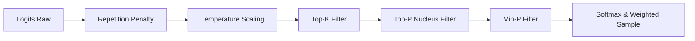

# 🔤 Kuro-Neko — Generation and Inference (`generate`)

The `generate` subcommand allows performing autoregressive text inference from a seed text (*prompt*). It loads the trained weights saved in `model_output/` together with the architecture configuration (`config.json`) and the BPE tokenizer (`custom_tokenizer.json`), generating tokens consecutively through a pipeline optimized with **KV Cache** (Key-Value Cache) and advanced stochastic sampling.

---

## ⚙️ Complete CLI Parameters Table

| Flag / Argument | Type | Default Value | Detailed Description |
| :--- | :--- | :--- | :--- |
| `<prompt>` *(Positional)* | `String` | **Required** | Input seed text from which the model will continue generating text. |
| `--temp <float>` | `f32` | `0.9` | Sampling temperature ($T$). Scales the logits before softmax. Higher values increase diversity/creativity, while values close to `0.0` make the result deterministic. |
| `--top-k <n>` | `usize` | `60` | Top-K sampling. Restricts the selection to only the $K$ tokens with the highest probability, discarding the rest. |
| `--top-p <float>` | `f32` | `0.9` | Nucleus sampling (Top-P). Keeps the minimal set of tokens whose cumulative probability sum reaches or exceeds the threshold $p$. |
| `--min-p <float>` | `f32` | `0.1` | Min-P threshold. Excludes any token whose probability is lower than $\text{min\_p} \times P_{\max}$, eliminating the "noisy tail" of flat distributions. |
| `--rep-penalty <float>` | `f32` | `1.6` | Repetition penalty. Applies a dividing factor to the logits of tokens that have already been generated previously in the sequence. `1.0` disables it. |
| `--max-tokens <n>` | `usize` | `50` | Maximum number of new tokens to generate autoregressively. |
| `--seed <n>` | `Option<u64>` | `None` *(System time)* | Random seed for the `XorshiftRng` generator. Allows reproducing exactly the same text output. |

---

## 🎯 Detailed Explanation of Sampling Strategies

Kuro-Neko applies a sequential pipeline of filtering and transformation on the unnormalized logits vector $z \in \mathbb{R}^{V}$ to select the next token:



### 1. Repetition Penalty
For each token $i$ that is already present in the context or in the previously generated text, its logit $z_i$ is adjusted according to:
$$z_i \leftarrow \begin{cases} z_i / \text{rep\_penalty} & \text{if } z_i > 0 \\ z_i \times \text{rep\_penalty} & \text{if } z_i \le 0 \end{cases}$$
A value such as `1.5` or `1.6` strongly discourages infinite repetition loops (essential in SLMs trained with a lot of repetitive text).

### 2. Temperature Scaling
The modified logits are divided by temperature $T$:
$$z_i' = \frac{z_i}{T}$$
- If $T \to 0$, the distribution concentrates on the token with the highest probability (greedy search).
- If $T > 1.0$, the probability distribution flattens, giving more opportunity to less frequent tokens.

### 3. Top-K Sampling
The logits are sorted in descending order and only the top $K$ positions are kept. All other positions in the logits vector receive a value of $-\infty$ (or $-10^4$), removing them from the probability calculation.

### 4. Nucleus Sampling (Top-P)
After applying Softmax to the filtered logits, probabilities are accumulated in descending order. The smallest subset of tokens $\mathcal{S}$ is kept such that:
$$\sum_{j \in \mathcal{S}} P(j) \ge p$$
Tokens outside this accumulated set are discarded. This dynamically adapts the number of candidates according to the model's uncertainty.

### 5. Min-P Thresholding
Min-P is a modern stochastic filtering technique. Let $P_{\max} = \max_i P(i)$ be the probability of the most probable token. A token $k$ is kept only if it satisfies:
$$P(k) \ge \text{min\_p} \times P_{\max}$$
If the main candidate token has an 80% probability and `min_p = 0.05`, only tokens with at least $4\%$ probability will be considered ($0.05 \times 0.80$).

### 6. Sampling with the XorshiftRng Generator
Finally, the resulting probabilities are re-normalized and the selected token is sampled using an ultra-fast pseudo-random generator `XorshiftRng`:

```rust
let mut rng = XorshiftRng::new(seed);
let r = rng.next_f32();
```

---

## ⚙️ Recommended Generation Profiles

> [!NOTE]
> Small models (SLM) such as Kuro-Neko assign highly concentrated probabilities to the most frequent tokens. With low temperatures or weak penalties the model can fall into repetition loops. For SLMs, `temp >= 0.8` and `rep_penalty >= 1.5` are recommended.

### 🎨 Creative Profile (Story writing, poetry, ideas)
Maximizes variability and vocabulary without losing grammatical coherence:
```bash
cargo run --release -- generate "In a distant galaxy" \
  --temp 0.9 \
  --top-k 60 \
  --top-p 0.90 \
  --min-p 0.10 \
  --rep-penalty 1.60 \
  --max-tokens 100
```

### 🎯 Deterministic / Technical Profile (Code, facts, summaries)
Concise and direct answers focused on the token with the highest probability:
```bash
cargo run --release -- generate "The function of RMSNorm is" \
  --temp 0.5 \
  --top-k 30 \
  --top-p 0.85 \
  --min-p 0.15 \
  --rep-penalty 1.80 \
  --max-tokens 50
```

### ⚖️ Balanced Profile (General Use)
Optimal balance between diversity and precision (CLI defaults):
```bash
cargo run --release -- generate "Once upon a time" \
  --temp 0.9 \
  --top-k 60 \
  --top-p 0.90 \
  --min-p 0.10 \
  --rep-penalty 1.60 \
  --max-tokens 60
```

---

## ⚡ How the KV Cache Works (Prefill & Decode)

To achieve extremely fast text generation on GPU without recomputing the key and value tensors for past tokens at each step, Kuro-Neko uses a **`KvCache`** structure:

```rust
pub struct KvCache<B: Backend> {
    pub k: Option<Tensor<B, 4>>,
    pub v: Option<Tensor<B, 4>>,
}
```

The inference process is divided into two distinct phases:

### Phase 1: Prefill (Prompt Evaluation)
1. The initial text (*prompt*) of length $S$ is converted to tokens and fed into the model in a single parallel pass.
2. Each attention block computes the matrices $K \in \mathbb{R}^{B \times H_{\text{kv}} \times S \times D}$ and $V \in \mathbb{R}^{B \times H_{\text{kv}} \times S \times D}$.
3. These initial matrices are stored inside the `KvCache` structure corresponding to each Transformer layer.

### Phase 2: Decode (Step-by-Step Autoregressive Generation)
1. To generate token $N+1$, only the **last generated token** (length $S = 1$) is passed to the model.
2. The model computes only the projections $K_{\text{new}}$ and $V_{\text{new}}$ for that individual token.
3. Using `Tensor::cat`, the new key and value are concatenated to the preexisting tensor in GPU memory:
   $$K_{\text{total}} = [K_{\text{previous}} \,;\, K_{\text{new}}]$$
   $$V_{\text{total}} = [V_{\text{previous}} \,;\, V_{\text{new}}]$$
4. This reduces the computational complexity per generated token from $O(S^2)$ to **$O(1)$**, accelerating inference exponentially.
